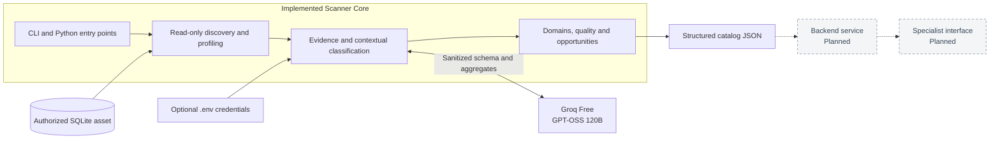
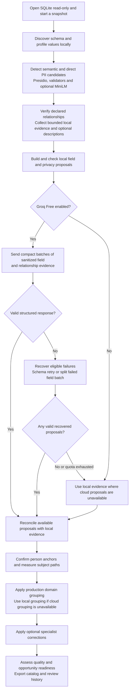

<div align="center">

# Data Discovery & Classification

**Scanner Core for Elm Challenge 1**

[](#development-status)
[](#getting-started)
[](#scanner-pipeline)
[](#getting-started)

[Overview](#project-overview) ? [Architecture](#system-architecture) ? [Quickstart](#getting-started) ? [Evaluation](#evaluation-and-current-limitations) ? [Handover](docs/SCANNER_CORE_HANDOVER.md)

</div>

## Project Overview

Database names and SQL types rarely tell a data steward enough about what records mean, whom they describe, or how they can be used. The Scanner Core inspects authorized SQLite databases and exports an evidence-backed catalog of their schema, sensitive fields, business domains, quality issues, and potential uses.

The prototype supports the six Elm Challenge 1 requirements through a read-only asset inventory, field and relationship analysis, domain assignment and descriptions, and quality-aware opportunities. Specialists can review uncertain decisions and apply recorded corrections.

## Key Features

| Capability | Scanner Core output |
| --- | --- |
| Discovery and profiling | Asset scope, owner supplied by the operator, schema, keys, relationships, and aggregate profiles |
| Semantic classification | Field meaning, category, specific type, supporting evidence, and explicit uncertainty |
| Domain grouping | Business groups, field membership reasons, boundaries, and cross-domain relationships |
| Direct PII detection | Local Presidio evidence and format checks, including Saudi identifier validators |
| Person-linked data | Verified join paths, person-anchor evidence, and linkage explanations |
| Confidence and review | Heuristic semantic confidence, review dimensions, correction input, and review history |
| Quality and opportunities | Quality checks and potential uses with technical readiness and usage restrictions |

## System Architecture



## Scanner Pipeline



Source values and free-text metadata stay local. The Groq path sends only allowlisted hints, bucketed evidence, and compact relationship context. Successful recovery fragments are retained, and fields without a usable response continue through local classification.

## Classification Approach

| Decision | Evidence used |
| --- | --- |
| Semantic type | SQL storage type, metadata, local value patterns, neighboring fields, and structured Groq proposals when enabled |
| Domain membership | Subject and business purpose, field context, and corroborating relationships. A foreign key alone does not establish shared purpose |
| Direct PII | Locally checked formats and content evidence, with contact ownership considered separately |
| Person-linked data | Corroborated person anchors plus measured paths through declared relationships. Path evidence and review requirements are exported |
| Uncertainty | Unresolved or conflicting semantics, domain, privacy, or format evidence can trigger specialist review |

## Technology Stack

| Layer | Technology |
| --- | --- |
| Runtime and data access | Python 3.11, SQLite, SQLAlchemy |
| Local evidence | Microsoft Presidio, phonenumbers, spaCy, optional MiniLM through ONNX Runtime |
| Cloud reasoning | Groq Free, GPT?OSS 120B, HTTPX, structured JSON |
| Evaluation | Synthetic SQLite fixtures, sealed labels, pytest, per-database metrics |

## Repository Structure

```text
.
??? backend/
?   ??? app/                       # Scanner Core Python modules
?   ?   ??? connectors/            # Read-only SQLite access
?   ?   ??? discovery/             # Schema and relationships
?   ?   ??? profiling/             # Aggregate value profiles
?   ?   ??? classification/        # Local evidence, Groq and privacy paths
?   ?   ??? intelligence/          # Domains, quality and opportunities
?   ??? requirements.txt
??? scripts/scan_data_asset.py     # CLI and AssetScan API
??? evaluation/                    # Evaluators and benchmark reports
??? docs/                          # Integration guide and synthetic output excerpt
??? tests/                         # Regression tests
??? frontend/                      # Reserved for the frontend team
??? .env.example                   # Empty local configuration template
```

## Getting Started

Run from the repository root. The examples use PowerShell. On macOS or Linux, activate the virtual environment with `source .venv/bin/activate` and copy the environment template with `cp`.

```powershell
python -m venv .venv
.\.venv\Scripts\Activate.ps1
python -m pip install -r backend/requirements.txt
```

The optional English NER and MiniLM assets were present during the reported benchmarks. Install them to match the evaluated local evidence setup.

```powershell
python -m pip install https://github.com/explosion/spacy-models/releases/download/en_core_web_md-3.8.0/en_core_web_md-3.8.0-py3-none-any.whl
hf download sentence-transformers/paraphrase-multilingual-MiniLM-L12-v2 tokenizer.json onnx/model.onnx --revision e8f8c211226b894fcb81acc59f3b34ba3efd5f42 --local-dir .models/minilm
```

Generate a synthetic source, then use the Scanner Core in local mode.

```powershell
python -m scripts.run_pipeline --without-embeddings --offline --output-dir data/demo
python -m scripts.scan_data_asset data/demo/synthetic.sqlite data/demo/catalog.json --offline --owner "Demo data steward"
```

To use the evaluated cloud model, create a key in a Groq Free project without billing, copy the template to `.env`, and fill in `GROQ_API_KEY`. Set Zero Data Retention in the Groq organization. The scanner reads `.env` from the current working directory.

```powershell
if (-not (Test-Path .env)) { Copy-Item .env.example .env }
# Open .env locally and set GROQ_API_KEY.
python -m scripts.scan_data_asset data/demo/synthetic.sqlite data/demo/catalog_groq.json --free-provider groq
python -m pytest -q
```

The default CLI is local. The Groq option selects the fixed GPT?OSS 120B model. Experimental grouping and alternative models require explicit invocation. A fresh setup can skip regression cases that require optional assets. See the [integration guide](docs/SCANNER_CORE_HANDOVER.md) for inputs, model assets, and the Python interface.

## Example Output

This excerpt comes from an actual offline scan of the bundled synthetic generator. The full catalog includes schema, evidence, domains, quality, opportunities, and review metadata.

```json
{
  "table_name": "customers",
  "column_name": "email",
  "semantic_type": "email_address",
  "data_domain": "customer",
  "personal_data": "yes",
  "personal_linkage": "direct",
  "confidence": 0.96,
  "review_required": false,
  "context_status": "offline"
}
```

[Sanitized catalog excerpt](docs/examples/scanner-output.json)

## Evaluation and Current Limitations

This is a **functional prototype for assisted cataloging**. The 85% targets have not been fully achieved. One sealed 93-field, three-schema run of the production model measured **84.9% exact semantic accuracy**, **85.2% domain membership F1**, **92.3% direct PII precision**, **100% direct PII recall**, and **62.5% person-linked F1**. At **49.5% automated coverage**, **20 of 46** automated decisions were jointly correct.

Confidence estimates the strength of semantic evidence. It is a heuristic score and has not reliably ranked joint correctness across semantic, domain, and privacy decisions. Results vary by schema. A verified join can show reachability to a person without establishing that the field describes that person. Free-tier quotas can interrupt cloud processing.

[Published metrics](evaluation/results/scanner_core_metrics.json) ? [Groq recovery](evaluation/GROQ_ARCHITECTURE_VALIDATION.md) ? [Domain annotation](evaluation/DOMAIN_ANNOTATION_GUIDELINES.md) ? [Verifier evaluation](evaluation/GROQ_VERIFIER_VALIDATION.md) ? [Model comparison](evaluation/GROQ_MODEL_COMPARISON.md)

## Development Status

| Component | Status | Team boundary |
| --- | --- | --- |
| Scanner Core | **Implemented** | Read-only scan, classification, catalog export, and evaluation |
| Backend | **Planned** | Service integration, authorization, job execution, and managed storage |
| Frontend | **Planned** | Catalog exploration and specialist review workflow |

[Scanner Core handover](docs/SCANNER_CORE_HANDOVER.md) ? [Upstream notices](licenses/)
